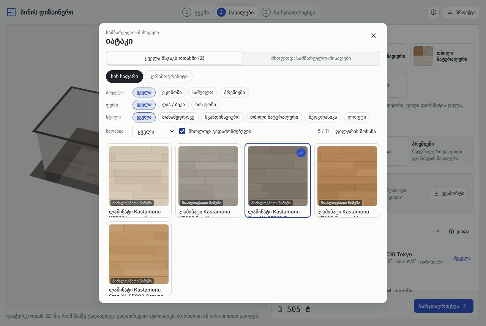
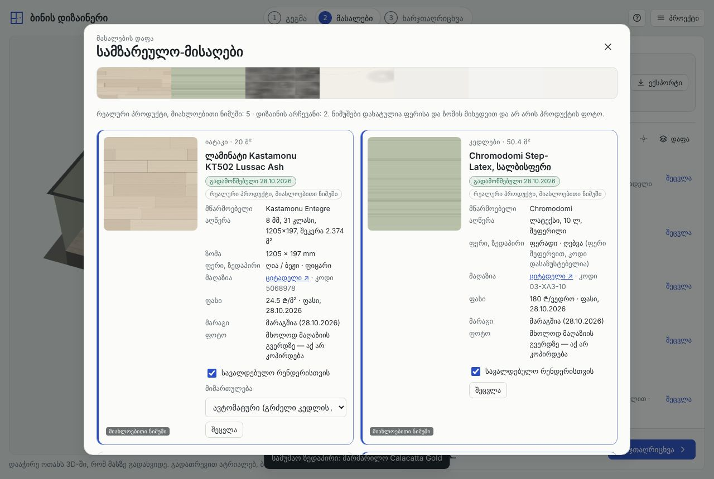
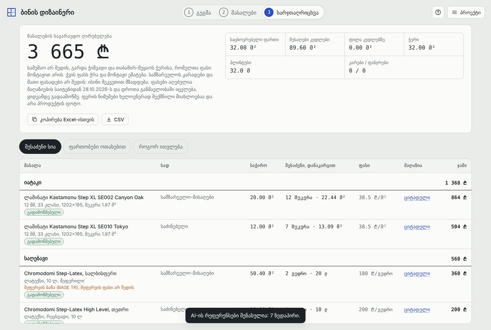
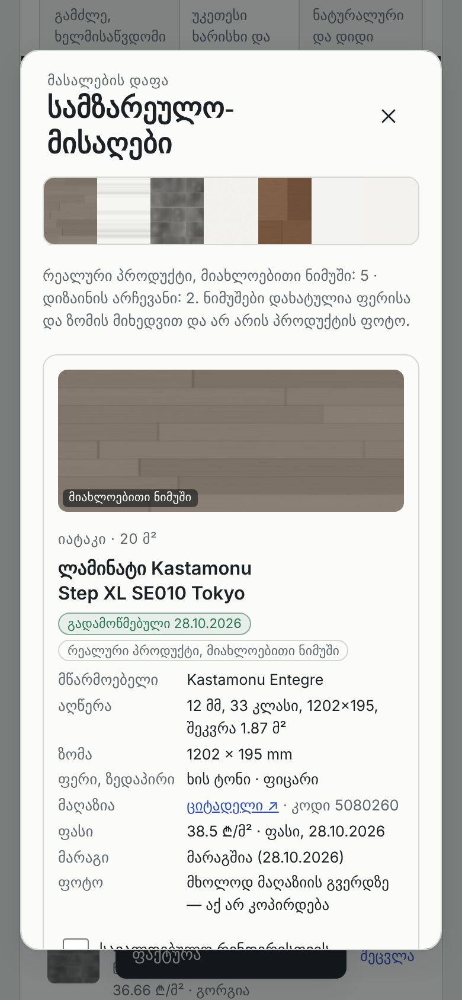

# Stage 04 — real products and AI material references

Branch `feat/bina-04-material-references`, based on `main` after the Stage 03 merge (`86f2a04`).

## Result

- Every catalog entry (89) now has a **product record** (`src/core/products.js`): stable id, product and manufacturer name, category and compatible surfaces, description, unit size and thickness, selling unit, colour, finish, pattern, retailer and product URL, price with currency and basis, price date, **verification level**, availability (only when actually checked), and the image situation.
- **Seven shop pages were re-read on 28.10.2026** (Citadeli). They back 12 catalog entries: 5 laminates and the Chromodomi Step-Latex white paint plus the tinting base that the 6 tinted colours use. Two errors were found and fixed:
  - `paint_mid_white` was priced at 180 ₾. That is the price of the **tinting base** (BASE TR). The white paint is a separate product at **200 ₾**, and it now links to its own page.
  - The KT502 decor is **Lussac** Ash, not "Lissac".
- The materials step gains:
  - filters for budget, colour, style, retailer, and "verified only"
  - provenance badges on every row and card
  - a link to the shop page
  - a **material board** per room, plus one for the whole apartment
  - export of the **AI reference package**
- **Kitchen cabinet fronts** are a new surface. They are design preferences: no price, no shop, and not in the purchase list. The 3D kitchen cabinets wear the chosen front.
- The estimate page shows each line's verification level. The CSV export gains product id, status and price date. The exclusion of cabinets is stated.
- Existing quantity calculations are unchanged. The sample apartment totals 15,206 ₾ before and after.

| | |
|---|---|
|  |  |
|  |  |

## Verification levels

| Level | Meaning | Entries |
|---|---|---|
| `verified` | product page re-read on the given date; name, shop code, price, unit and stock recorded in `VERIFIED` | 12 (7 pages) |
| `listed` | price from this exact product's page (collected 28.10.2026), not re-read since | 45 |
| `indicative` | category or collection page, a "from" price, or a page shared with another product | 17 |
| `estimate` | assembled set, calculated system, or an article figure | 8 |
| `preference` | not a shop product; a described look | 7 |

Rules enforced by tests:
- Nothing is `verified` without an evidence record.
- Evidence price must equal the catalog price.
- The link must be on the shop's own domain.
- No shop code or "in stock" is shown without a page read.

### Verified records (28.10.2026, citadeli.com)

| id | page shows | shop code | price | stock |
|---|---|---|---|---|
| `lam_kt502` | Laminate KT 502 LUSSAC ASH, Kastamonu Entegre, 8×197×1205, grade 31, 10 planks | 5068978 | 24.50 ₾/m² | in stock |
| `lam_kt503` | KT503 BOZ YAZI 31 class 2.374 m², Kastamonu Entegre, Turkey | 5068979 | 24.50 ₾/m² | in stock |
| `lam_kt405` | KT405 CANYON MEŞE 32 class 1.899 m², Kastamonu Entegre, Turkey | 5053746 | 25.50 ₾/m² | in stock |
| `lam_se002` | STEPXL SE002 CANYON OAK 33 class AC5, 8 planks 1.87 m² | 5080102 | 38.50 ₾/m² | in stock |
| `lam_se010` | STEPXL SE010 TOKYO 33 class AC5, 8 planks 1.87 m² | 5080260 | 38.50 ₾/m² | in stock |
| `paint_mid_white` | STEP-LATEX HIGH LEVEL WHITE 10LT, Chromodomi | 01-ΣΛX-10 | 200 ₾ | in stock |
| `paint_mid_*` (6 tints) | STEP-LATEX HIGH LEVEL (BASE TR) 10LT, Chromodomi | 03-XΛ3-10 | 180 ₾ | in stock |

Notes on these records:
- KT502's page does not state the pack area. The 2.374 m² comes from the identical-size KT503 page, and the record says so.
- No paint page states coverage in m²/l. The 10 m²/l used by the estimate stays an assumption.
- For tinted colours the product (the base) is verified but the **colour is a preference**: no colour code is recorded. The board and the package say this.

Why not more: from this environment only Citadeli pages could be opened. Gorgia, Nova, Zodi, Allstone and Vitra pages were not reachable, so their 45 product-page records stay `listed` and were not upgraded.

## Pictures: licensing, CORS, broken links, storage

What was checked:
- Citadeli product pages show photos under `citadeli.com/upload/products/…`.
- No licence or reuse permission is stated on the pages.
- The terms page could not be opened from here.

Decisions:
1. **No retailer image is copied, bundled or hot-linked.** Treating the photos as all rights reserved is the only safe reading. Hot-linking would also:
   - depend on a third-party server, file names and CORS behaviour (canvas textures from another origin need CORS headers the shops do not promise)
   - break silently when a shop renames a file
   - leak every visitor's IP address to the shop
2. The product page is **linked** (`retailerPhoto.linkOnly`, "photo on the shop page — not copied here").
3. Every on-screen sample is **drawn by the program** from the recorded colour and size, and it is captioned "მიახლოებითი ნიმუში" (approximate sample) everywhere.
4. A real photo can be added only through `IMAGES` in `products.js`, and `validateImage` requires all of the following. Tests reject a retailer URL, path traversal, SVG, an unknown licence, or a missing holder or date.
   - a file under this site's own `/assets/materials/` (long-term storage we control, versioned with the site)
   - a raster format
   - a licence: own photo, written permission with a reference, CC BY or CC0
   - the rights holder
   - the date the permission was checked
5. **Broken links:** product URLs are kept with their price date, and the board, picker and estimate show that date. A periodic link-and-price check is a follow-up. It needs network access to the shops that this sandbox does not have.

The catalog therefore ships **0 licensed photos**. Every real product is a `product-approx` reference, and the `product-image` path is implemented and tested but empty until permissions exist.

## AI reference package

`referencePackage(project)` in `src/core/references.js`. The UI exports it as `<project>-materials.json` (whole apartment, or one room from its board).

```jsonc
{
  "format": "bina.material-references", "version": 1, "generatedAt": "…",
  "project": { "name", "style", "tier", "rooms": [{ "id", "label", "purpose", "areaM2" }] },
  "kinds": { "product-image": "…", "product-approx": "…", "preference": "…" },
  "references": [{
    "key": "k|floor",                       // room id (or *) | surface
    "target": { "roomId", "roomLabel", "roomPurpose", "surface", "surfaceLabel", "areaM2" },
    "materialId": "lam_kt502",              // exact catalog id
    "chosenBy": "room" | "apartment" | "style",
    "kind": "product-image" | "product-approx" | "preference",
    "mandatory": true,                      // the user's choice is binding by default; style defaults are flexible
    "priced": true,
    "material": { "name", "manufacturer", "colorHex", "colorFamily", "colorIsPreference", "finish", "pattern", "unitSize", "thicknessMm" },
    "identity": { "retailer", "retailerCode", "productUrl", "verification", "verifiedOn", "price", "availability" }, // null for a preference
    "visual": { "image": null, "retailerPage": "https://…", "swatch": "synthetic-approximate" },
    "layout": { "pattern": "staggered", "direction": "along", "planAxis": "x", "en": "long side parallel to the longest wall" },
    "prompt": "Floor of the kitchen-living room: light beige (approx. #d6c9b4) wood planks; unit size 1205 × 197 mm; …"
  }]
}
```

Additional behaviour:
- The board lets the user switch each finish between **mandatory** and **flexible**, and set plank direction (along or across the longest wall).
- Both settings are saved in `finish.refs`. They are validated on load and dropped with a deleted room. They never change the estimate.
- The `prompt` sentence is built only from recorded fields and contains no links.

## Acceptance

`test/materials.test.js` (Node) and `test/e2e/materials.mjs` (browser) both run this scenario. A user picks floor **KT502**, wall colour **Step-Latex sage**, and countertop **Calacatta Gold** for the kitchen-living room. Then:
- `finish.rooms.k` is exactly `{ floor: 'lam_kt502', walls: 'paint_mid_sage', countertop: 'st_calacatta' }`, and it survives save/load.
- The room board shows the three products with their provenance. The exported package has the three ids, marked mandatory and `product-approx`.
- Changing the floor to **SE002** changes only the floor reference. Every other reference is deep-equal.
- Every other purchase line keeps the same quantity and cost. The floor keeps its 20 m²: 21.4 m² with waste → 12 packs of 1.87 m² → 22.44 × 38.50 ₾.
- The total on screen equals `computeEstimate` of the saved project.
- Cabinet fronts and reference settings leave the total unchanged.

## Tests

- `npm test`: **92 pass**, 16 of them new in `test/materials.test.js`.
- The existing catalog test now also asserts that preferences carry no price or shop.
- Mutation check: a wrong verified price or a retailer image hot-link each make the provenance tests fail.
- `node test/e2e/materials.mjs`: pass, desktop and phone.
- `node test/e2e/acceptance.mjs` (Stage 03): still passes.
- The Stage 01 and 02 browser audits (flows, touch, robustness) give identical results on `main` and this branch.

## Limitations and next steps

- 45 `listed` and 17 `indicative` prices are as collected on 28.10.2026 and were not re-read. Gorgia, Nova, Zodi, Allstone and Vitra need checking from a network that can reach them.
- No licensed photos yet. Asking the retailers or manufacturers (Kastamonu, Bien, Vitra) for written permission is the way to fill `IMAGES`.
- Tinted paint colours have no colour code (NCS or a shop palette). Recording the code would turn the colour from a preference into a product fact.
- Cabinet fronts are not priced. Kitchens are made to order, and a price would need a joiner's quote.
- Availability is a snapshot from the verification date, not live stock.
