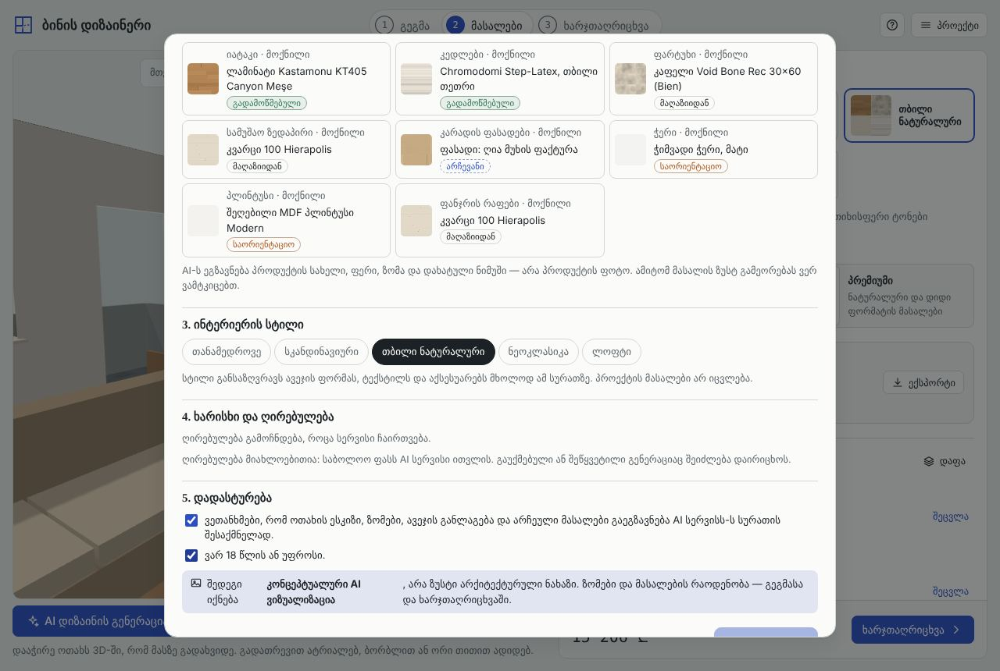
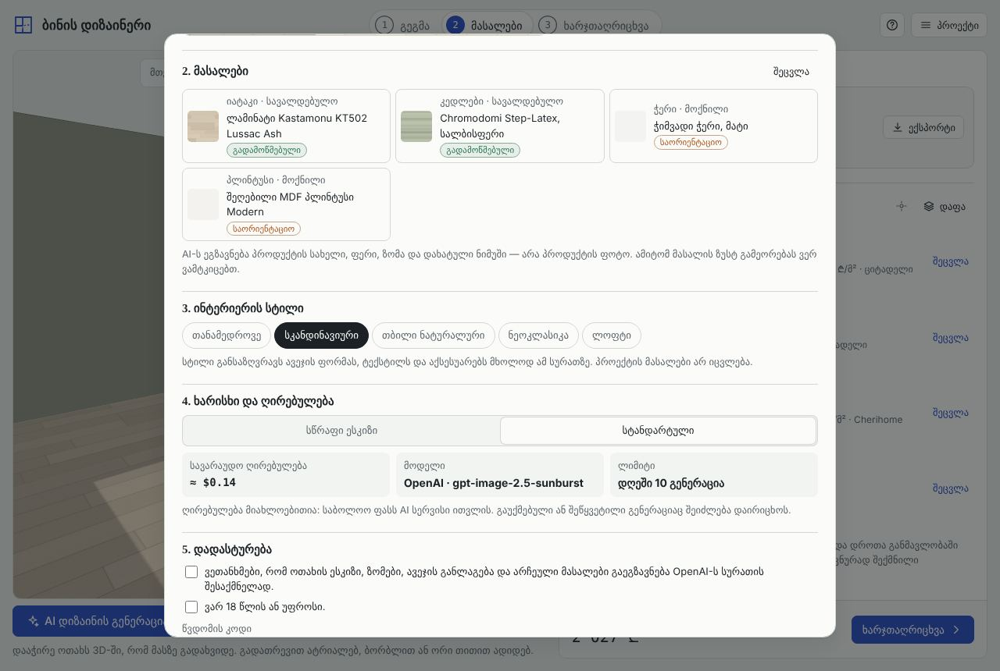
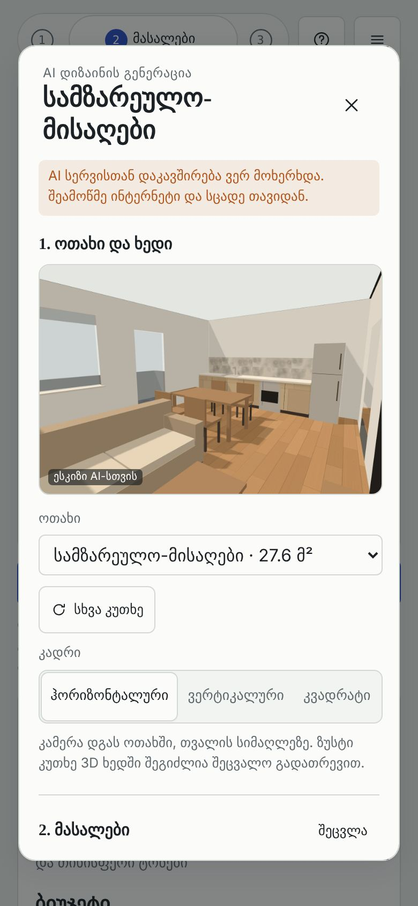
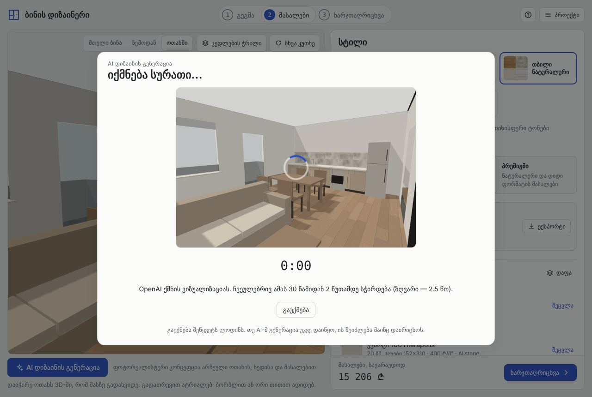
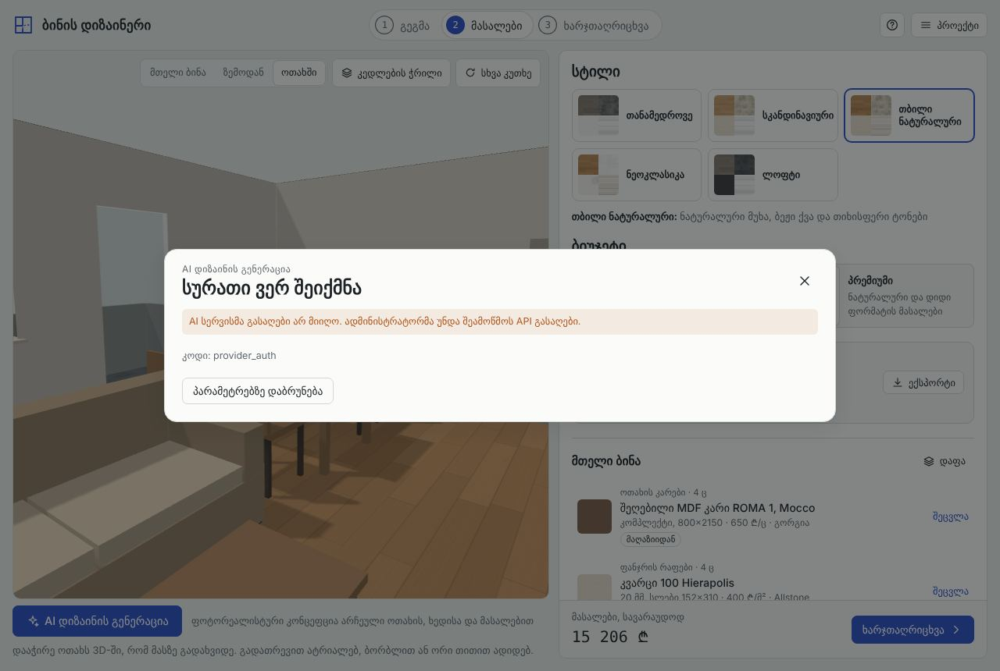
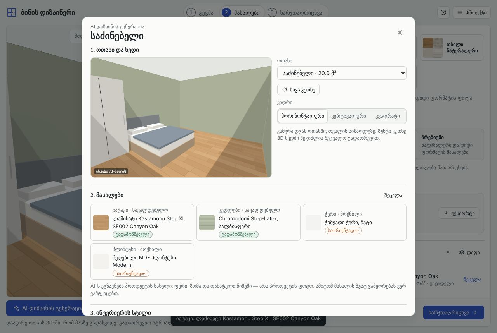

# Stage 06 — verification report

Branch `feat/bina-06-ai-rendering`, based on `main` after Stage 04 (`d946c30`).

## Status in one line

The feature is implemented end to end: button, dialog, scene, sketch, server, provider adapters, cost controls, saving and labelling. It is tested with **mocked providers**. **No live AI image has been generated yet**, because no provider credentials or billing authorisation exist in this environment. Live verification is the one remaining step and needs an administrator (see "Blocked" below).

## What was built

| Part | Where |
|---|---|
| Structured scene specification v1 + content-hash revision, validation | `src/core/scene.js` |
| Instructions for the model, built only from enums and catalog data | `src/core/render-prompt.js` |
| Pages Functions: `GET /api/render/config`, `POST /api/render` | `functions/api/render/` |
| Render service: config gates, input limits, access codes, consent, cost estimate and acceptance, D1 quotas, rate limit and budget, OpenAI + Gemini adapters, timeout, cancellation, fallback | `server/render/` |
| 3D sketch capture at the output frame | `src/ui/view3d.js` (`snapshot`) |
| Dialog: room and viewpoint, materials review, style, quality and cost, consent, progress and cancel, errors, result with label, save, download, regenerate, saved gallery with "plan changed" | `src/ui/ai-render.js` |
| Image storage in the browser (IndexedDB); render records in the project (`renders`, validated on load) | `src/ui/render-store.js`, `src/core/model.js` |
| Docs | `PROVIDERS.md`, `SETUP.md`, this file |

The scene specification stands in for a separate Stage 05, which is not in the repository. It describes:
- the room: purpose, size, polygon, ceiling, walls with compass direction and side as seen from the camera
- openings with sizes, sills and where they lead
- furniture with sizes, position and rotation
- every chosen finish, including the door and sill finishes when the room has them, as catalog ids with "use as specified" or "may be adjusted"
- the camera and the style

Its revision changes with anything that changes the picture, and only then: moving the room on the plan or repainting another room does not change it.

## Automated tests (`npm test`: 127 pass)

| Suite | Tests | Covers |
|---|---|---|
| `test/render-server.test.js` | 25 | the real handler, real SQL (D1 API over Node SQLite) and a **mock provider**: see below |
| `test/scene.test.js` | 8 | scene contents for the 4×5 m bedroom; sides seen from the camera; lossless validation (same revision in the browser and on the server); revision changes; rejection of malformed scenes and stripping of client text; prompt contents; validation of saved renders |
| `test/render-bundle.test.js` | 2 | both Functions bundle for the Workers runtime without Node built-ins; the browser bundle contains no provider endpoint, header or key name |
| earlier suites | 92 | unchanged |

`render-server.test.js` checks the following.
- **Nothing billable without configuration:**
  - disabled
  - each missing piece: key, budget, salt, D1, codes
  - unpriced model
  - zero budget
- **Refused before any provider call:**
  - wrong origin
  - missing or wrong access code
  - no consent
  - no accepted cost
  - bad JSON
  - quality or count above the admin limit
  - an image whose bytes don't match its type
  - a URL instead of an image
  - a malformed scene or wrong revision
  - over the per-request cost cap
  - oversized upload
  - accepted cost below the estimate (409 with the new estimate)
- **The acceptance request:**
  - exact OpenAI call: endpoint, model, size, quality, sketch as Image 1, two samples
  - prompt with 4.00 × 5.00 m, the 1.60 × 2.00 m bed, the wardrobe, KT502 and the Scandinavian style
  - the response is tied to the scene revision
  - the real cost is taken from `usage`
  - only hashed ids are stored
- **Client text cannot reach the prompt.**
- **Provider failures:**
  - invalid key → `provider_auth`, attempt released
  - rate limit → `provider_rate_limited`, `Retry-After` passed on, released
  - out of credit → administrator error
  - safety refusal → `provider_refused`, cost kept
  - server error → retryable, cost kept
  - server error with fallback → Gemini request shape checked, result marked `fallbackUsed`
  - fallback skipped when it would cost more than the user accepted
  - Gemini safety finish and invalid key
  - a response without an image
- **Timeout:** the provider request is aborted, 504, cost kept.
- **User cancellation:** the browser's abort reaches the provider request, 499, recorded as cancelled.
- **Quotas:**
  - per-user per day (per access code)
  - per address per minute (with recovery after 60 s)
  - monthly budget, including **two simultaneous requests with room for one: exactly one reaches the provider**
  - one job at a time per user
  - public mode keyed by an anonymous browser id

## Browser tests (headless Chromium, desktop and phone)

`node test/e2e/ai-render.mjs`: **pass**. The page uses the real handler and D1 SQL. The image provider is a **mock that returns the layout sketch it received** (so screenshots of "results" in tests are sketches, not AI images).

1. **Not configured** (today's production state): the button opens the dialog and the sketch is prepared, but "Generate" stays disabled with an explanation. Zero provider calls.
2. **Acceptance path:**
   - draw a 4 × 5 m bedroom
   - add a 160 × 200 bed and a wardrobe from the library
   - choose KT502 floor and sage walls in the picker
   - open the dialog: the room is preselected and the materials are listed
   - change the camera corner, pick the Scandinavian style; the estimate (≈ $0.14) and model are shown
   - confirm, enter the code, generate
   - the server→provider request carries the real sketch (>20 kB JPEG) and the right prompt
   - the result shows the label "AI კონცეფცია — არა ზუსტი ნახაზი" and its scene revision
   - "save" adds a render record (revision, room, style, cost from usage) and the image to IndexedDB
   - **the rest of the project is byte-for-byte unchanged**
   - the download is stamped with the label
   - after reload and a floor change, the saved render shows "გეგმა შეიცვალა" (plan changed)
3. **Failures as the user sees them:** invalid provider key, wrong access code, provider overloaded, provider down, timeout, daily quota, and cancel during generation. Each shows a specific Georgian message, and nothing is saved.

Earlier suites still pass on this branch: `test/e2e/materials.mjs` (Stage 04) and `test/e2e/acceptance.mjs` (Stage 03).

| | |
|---|---|
|  |  |
|  |  |
|  |  |

## Honest-result rules, as implemented

- Every result shows the label, and the label is stamped onto downloaded images. The dialog explains that sizes and quantities come from the plan and the estimate.
- Material samples are described to the model as "drawn sample (approximate, not a photograph)". The UI says that exact reproduction of a product cannot be claimed.
- A result never changes the plan, the furniture, the finishes or the style of the project. Only the `renders` list grows, and a test checks this.
- Cost is shown as an estimate before generating and as the provider-reported cost after it. The basis is stated in both cases.

## Blocked: what needs credentials or authorisation

| Step | Needs | Who |
|---|---|---|
| A real image from `gpt-image-2.5-sunburst` for the 4 × 5 m bedroom, associated with its scene revision | OpenAI API key with billing, possibly organization verification | administrator |
| Real Gemini fallback image | Google AI Studio paid key | administrator (optional) |
| Production quotas and spending | D1 database bound as `BINA_DB` | administrator |
| CPU headroom for image payloads | Workers Paid plan | administrator |
| Cancel reaching the provider in production | compatibility flag `enable_request_signal` | administrator |
| Calibrating the GPT Image 2.5 cost estimate | the `usage` of the first real renders (compare with the estimate in D1) | after the first renders |

The steps are in [SETUP.md](SETUP.md). After them:
1. Open `/api/render/config` and expect `available: true`.
2. Run the acceptance path above on bina.lithos.ge with an access code.
3. Record the image, revision, latency and cost here.
