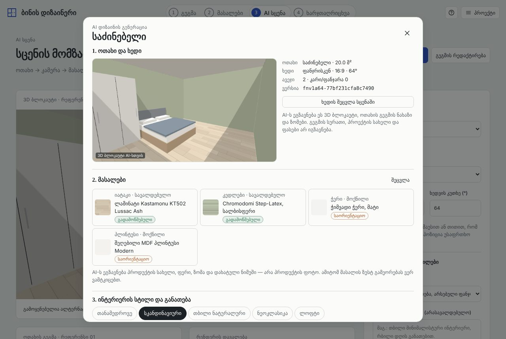
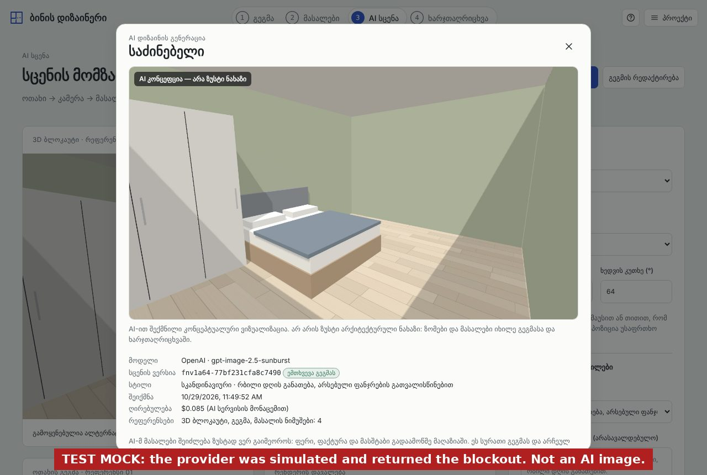
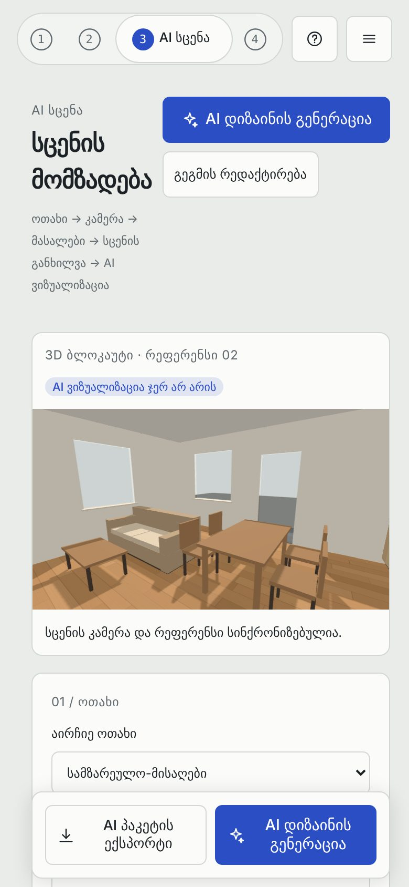

# Stage 06 — verification report

Branch `feat/bina-06-ai-rendering`. Base: `main` after Stage 04 (`d946c30`), merged with Stage 05 (`feat/bina-05-scene-composer`, `80e8c38`). **PR #3 (Stage 05) must be merged before this branch.** Merging #3 and then this branch into `main` was checked: there are no conflicts, and the result is identical to this branch.

## Status in one line

The feature is implemented end to end and renders from the Stage 05 scene:
- the button in the scene step, the dialog, the real 3D blockout and plan captures;
- the server's own check of the scene, the provider adapters and the cost controls;
- saving tied to the scene revision, and labelling.

It is tested with **mocked providers**. **No live AI image has been generated yet**, because no provider credentials or billing authorisation exist in this environment. Live verification is the one remaining step, and it needs an administrator (see "Blocked" below).

## What was built

| Part | Where |
|---|---|
| Stage 05 scene (`bina.ai-scene` v1) as the render input. `sceneRevisionOf()` recomputes a revision with the browser's rule; Stage 05's example packages reproduce their revisions. Optional **render-only style** that leaves the project style, materials and estimate unchanged. | `src/core/scene.js` |
| Server check of the Stage 05 contract (see `docs/stage05/stage06.md`): • JSON Schema • recomputed revision • walls vs polygon, openings on walls, furniture footprints • camera inside the room, away from furniture • catalog products on allowed surfaces • unresolved mandatory material → `422 unresolved_material` | `server/render/scene-check.js`, `server/render/json-schema.js` (no code generation, so it runs on Workers; checked against Ajv) |
| Instructions for the model, built from the checked scene and the server's catalog. Only the user's optional suggestion comes from the request, sent quoted and ranked below every constraint. | `src/core/render-prompt.js` |
| Pages Functions: `GET /api/render/config`, `POST /api/render` | `functions/api/render/` |
| Render service: • configuration gates, input limits, access codes, consent • estimate and acceptance (estimate never below recent real costs) • D1 quotas, rate limit and budget • OpenAI and Gemini adapters, timeout, cancellation, fallback | `server/render/` |
| Output frame = scene camera frame: 16:9 → 1536×864, 4:3 → 1536×1152, 1:1 → 1024×1024 | `server/render/cost.js` |
| "AI დიზაინის გენერაცია" in the scene step (header and bottom bar), and from Materials and its boards (opens the scene step for that room) | `src/ui/scene-composer.js`, `src/ui/materials.js`, `src/ui/app.js` |
| Dialog, in order: 1. room and view (the blockout preview that will be sent) 2. materials with provenance, and unresolved ones flagged 3. style and light 4. quality and cost 5. consent and access code then progress and cancel, errors, the labelled result, save, download, regenerate, and a saved gallery that shows "plan changed" | `src/ui/ai-render.js` |
| Render records: room, Stage 05 revision, camera, scene settings, frame, model, cost. Validated on load. "Current" means recompiling the scene from today's project gives the same revision. | `src/core/render-record.js`, `src/core/model.js` |
| Image storage in the browser (IndexedDB) | `src/ui/render-store.js` |

## Automated tests (`npm test`: 146 pass, 0 fail)

| Suite | Tests | Covers |
|---|---|---|
| `test/render-server.test.js` | 29 | the real handler, real SQL (the D1 API over Node SQLite) and a **mock provider**: see below |
| `test/render-scene.test.js` | 10 | details below |
| `test/render-bundle.test.js` | 2 | both Functions bundle for the Workers runtime without Node built-ins; the browser bundle contains no provider endpoint, header or key name |
| earlier suites, including Stage 05's `scene.test.js` (13) | 105 | unchanged and passing |

`render-scene.test.js` covers:
- the Workers validator agrees with Ajv on Stage 05's examples and on more than 60 mutations;
- unsupported schema keywords throw;
- revision identity with Stage 05;
- the render-only style does not change the project or the estimate;
- the acceptance prompt;
- the sides of the room as seen from the camera;
- flexible unresolved finishes are left out;
- prompt length;
- when a saved render is current or outdated (another room, a floor change, moved furniture, a camera now blocked, the room deleted);
- validation of saved records.

`render-server.test.js` checks the following.
- **Nothing billable without configuration:**
  - disabled
  - each missing piece: key, budget, salt, D1, codes
  - unpriced model
  - zero budget
- **Refused before any provider call:**
  - wrong origin
  - missing or wrong access code
  - no consent
  - no accepted cost
  - bad JSON
  - quality or count above the admin limit
  - an image whose bytes don't match its type
  - a URL instead of an image
  - a schema-invalid scene, a wrong revision (409)
  - **re-hashed tampered scenes:** furniture outside its footprint, camera outside the room, an opening off its wall. The revision rule is public, so the server checks geometry itself.
  - unresolved mandatory material (422)
  - over the per-request cost cap
  - oversized upload
  - accepted cost below the estimate (409 with the new estimate)
- **The acceptance request:**
  - the exact OpenAI call: endpoint, model, size **1536×864** (16:9 camera), quality, blockout as Image 1, plan as Image 2, two samples
  - the prompt has 4.00 × 5.00 m, the 1.60 × 2.00 m bed, the wardrobe, KT502 and the Scandinavian style
  - the response carries the scene revision, room, frame and references
  - the real cost is taken from `usage`
  - only hashed ids are stored
- 4:3 and 1:1 frames; the request without a plan image.
- **Client text cannot reach the prompt,** even inside a re-hashed scene. The one exception is the quoted suggestion.
- **Estimate calibration:** after an expensive real render, the next request at the old price gets 409 `estimate_changed` with the higher estimate.
- **Provider failures:**
  - invalid key → `provider_auth`, attempt released
  - rate limit → `provider_rate_limited`, `Retry-After` passed on, released
  - out of credit → administrator error
  - safety refusal → `provider_refused`, cost kept
  - server error → retryable, cost kept
  - server error with fallback → Gemini request shape checked (`aspectRatio` 16:9, blockout, plan, samples), result marked `fallbackUsed`
  - fallback skipped when it would cost more than the user accepted
  - Gemini safety finish and invalid key
  - a response without an image
- **Timeout:** the provider request is aborted, 504, cost kept.
- **User cancellation:** the browser's abort reaches the provider request, 499, recorded as cancelled.
- **Quotas:**
  - per user per day (per access code)
  - per address per minute (with recovery after 60 s)
  - monthly budget, including **two simultaneous requests with room for one: exactly one reaches the provider**
  - one job at a time per user
  - public mode keyed by an anonymous browser id

## Browser tests (headless Chromium, desktop and phone)

All four browser suites pass on this branch:
- `test/e2e/ai-render.mjs` (this stage)
- `test/e2e/scene.mjs` (Stage 05)
- `test/e2e/materials.mjs` (Stage 04)
- `test/e2e/acceptance.mjs` (Stage 03)

In `ai-render.mjs` the page uses the real handler and D1 SQL. The image provider is a **mock that returns the blockout it received**, so test "results" are blockouts, not AI images. Screenshot 07 is stamped "TEST MOCK" for this reason.

1. **Not configured** (today's production state): the dialog opens and the blockout is prepared, but "Generate" stays disabled with an explanation. Zero provider calls.
2. **Acceptance path:**
   1. Draw a 4 × 5 m bedroom.
   2. Add a 160 × 200 bed and a wardrobe from the library.
   3. Choose KT502 floor and sage walls.
   4. In the scene step, switch the camera to the window view and open **AI დიზაინის გენერაცია**. The room, view (16:9, FOV), revision and materials are shown.
   5. Pick the Scandinavian style for this picture. The upper estimate and the model are shown.
   6. Confirm, enter the code, generate.
   7. The server→provider request has size 1536×864, the real blockout (>20 kB JPEG) as Image 1, the plan as Image 2, samples and the right prompt.
   8. The result shows the label "AI კონცეფცია — არა ზუსტი ნახაზი" and its revision, which **equals the revision of the scene that was sent**.
   9. "Save" adds a render record (revision, room, frame, camera preset, style, cost from usage, project fingerprint) and puts the image in IndexedDB. **The rest of the project is byte-for-byte unchanged**, including the project style.
   10. The download is named after the revision and stamped with the label.
   11. After a reload the render is "მიმდინარე" (current). After a floor change it shows "გეგმა შეიცვალა" (plan changed).
3. **Failures as the user sees them:** invalid provider key, wrong access code, provider overloaded, provider down, timeout, daily quota, and cancel during generation. Each shows a specific Georgian message, and nothing is saved.
4. **Phone (390 px):** the scene step and the dialog have no horizontal overflow, and the AI button sits next to the package export in the bottom bar.

| | |
|---|---|
|  |  |
|  |  |
|  |  |
|  |  |

## Honest-result rules, as implemented

- Every result shows the label, and the label is stamped onto downloaded images. The dialog explains that sizes and quantities come from the plan and the estimate.
- Material samples are described to the model as "drawn sample (approximate, not a photograph)". The UI says that exact reproduction of a product cannot be claimed. Design preferences are sent as preferences, not as products.
- A result never changes the plan, the furniture, the finishes or the project style. Only the `renders` list grows, and a test checks this.
- Cost is shown as an upper estimate before generating and as the provider-reported cost after it. The basis is stated in both cases.

## Blocked: what needs credentials or authorisation

| Step | Needs | Who |
|---|---|---|
| Stage 05 in `main` | merge PR #3, then this PR | repository owner |
| A real image from `gpt-image-2.5-sunburst` for the 4 × 5 m bedroom, tied to its scene revision | OpenAI API key with billing, possibly organization verification | administrator |
| Real Gemini fallback image | Google AI Studio paid key, `RENDER_FALLBACK=gemini` | administrator (optional) |
| Production quotas and spending | D1 database bound as `BINA_DB`; `RENDER_SALT`, `RENDER_ACCESS_CODES`, `RENDER_MONTHLY_BUDGET_USD`, `RENDER_ENABLED=true` | administrator |
| CPU headroom for image payloads | Workers Paid plan | administrator |
| Cancel reaching the provider in production | compatibility flag `enable_request_signal` | administrator |
| Checking the GPT Image 2.5 cost estimate | the `usage` of the first real renders (the server then calibrates itself from D1) | after the first renders |

The steps are in [SETUP.md](SETUP.md). After them:
1. Open `/api/render/config` and expect `available: true`.
2. Run the acceptance path above on bina.lithos.ge with an access code.
3. Record the image, revision, latency and cost here.
